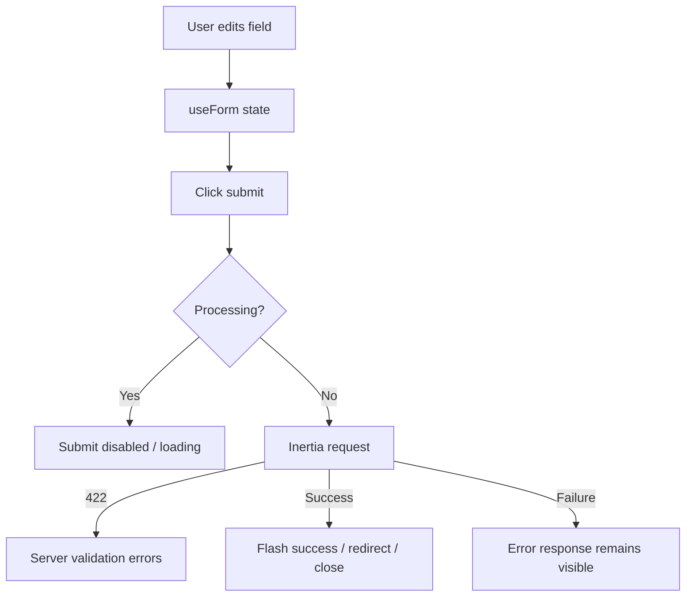

# Forms, Validation, and Submissions

## Form flow

## Web forms

| Form | Source | Fields | Submit | Validation / outcome |
|---|---|---|---|---|
| Login | `Pages/Login.tsx` `handleSubmit` | `email`, `password` | POST `api.auth.login` | `WebAuthController` receives `LoginRequest`; throttle `5,1`; processing disables button. Forgot/register are not implemented. |
| Resident emergency report | `Pages/Resident/Report.tsx` | `incident_type_id`, `reporter_type`, `location`, `lat`, `lng`, `description` | POST `resident.report.store` | `ResidentController::storeReport` validates required incident/location/description data; field errors render below fields. |
| Resident service request | `Pages/Resident/Schedule.tsx` | `service_type`, `preferred_date`, `preferred_time`, `address`, `notes` | POST `resident.schedule.store` | `ResidentController::storeSchedule`; required service/date/address fields render server errors; success resets form. |
| Dispatcher emergency call | `Pages/Dispatcher/Dashboard.tsx` `DispatchForm` | report id, incident type, caller, contact, reporter type, victim/witness details, location, coordinates, description | POST `dispatcher.dispatch.store` | `Dispatcher\DashboardController::store`; dispatch is disabled without an active auto-assigned team. |
| Patient care report | `Pages/Driver/Reports.tsx` | driver section, emergency section, sex/type selects, vital signs | PUT `driver.reports.form` | `SavePatientCareReportRequest` (`DriverController::saveForm`); form closes on success. |
| Admin incident type | `Pages/Admin/IncidentTypes/Index.tsx` | name, description, priority, color | POST `admin.incident-types.store` or PUT update | `IncidentTypeController` validates required fields and priority/color; errors show beside fields. |
| Admin announcement | `Pages/Admin/Announcements/Index.tsx` | title, category, description, image | multipart POST create; multipart POST with `_method=put` edit | `AnnouncementController` validates title/category/description/image; `forceFormData` supports image upload. |
| Admin user account | `Pages/Admin/Users/Index.tsx` | account fields shown by `Field`, role/status fields | POST/PUT `admin.users.store/update` | `UserController` validation; create success includes a temporary password in flash. |
| Dispatcher response team | `Pages/Dispatcher/Responders.tsx` | team name, status, members[] name/role | POST/PUT responders | `ResponderController::store/update`; at least one named member is required by UI/server validation. |
| Dispatcher shift | `Pages/Dispatcher/Responders.tsx` | start/end datetime, status, member ids | POST `dispatcher.shifts.store` | `ResponderController::storeShift`; end time and member selection errors render in dialog. |
| Schedule decline | `Pages/Dispatcher/Schedule.tsx` | reason | PATCH `dispatcher.schedule.decline` | Reason is required by UI (`!reason.trim()` disables button) and `ScheduleController` (`required`, max 500). |
| Report status/priority | `Pages/Admin/Reports/Show.tsx` | select values | PATCH `admin.reports.update` | Sends current status/priority plus changed value. |

## Request state conventions

- `form.processing` controls disabled submit buttons.
- `onSuccess` commonly closes a dialog or resets the form.
- `preserveScroll: true` is used for in-page mutations.
- Validation errors are read from `form.errors`; pages do not invent client-side validation beyond required UI gating.
- The server is the source of truth for validation. See controller methods under `app/Http/Controllers/Admin`, `Dispatcher`, `Driver`, and `Resident`.

## Mobile API forms

The repository also exposes mobile-only form endpoints in `routes/api.php`, including mobile login/register/reset, resident report/schedule creation, driver status/profile/patient/trip updates, account/avatar/password/deletion changes, staff account review, team/member/shift management, announcements, and incident types. These endpoints are not rendered by the React web pages; see [mobile-api.md](./modules/mobile-api.md).
