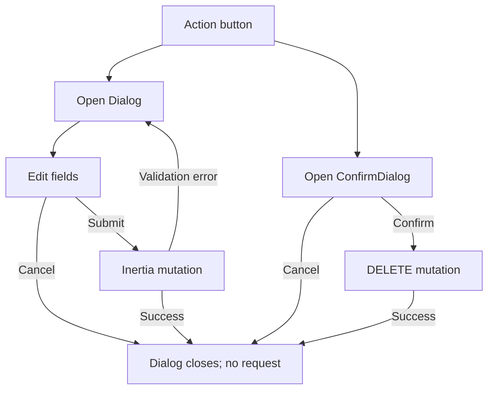

# Dialogs, Sheets, Popups, and Confirmation Flows

## Shared dialog primitives

| Component | Source | Behavior |
|---|---|---|
| `ConfirmDialog` | `resources/js/components/ConfirmDialog.tsx` | `AlertDialog` with title, description, Cancel, and destructive confirm action. Default confirm label is `Delete`. |
| `Dialog` family | `resources/js/components/ui/dialog.tsx` | Used for editable forms and detail views; `open` and `onOpenChange` control dismissal. |
| Mobile navigation sheet | `resources/js/Layouts/AppLayout.tsx` | `Sheet` opens from the menu button and closes after a link click. |
| Dropdown menus | `resources/js/components/ui/dropdown-menu.tsx` consumers | Used for legacy header controls; current `AppLayout` uses the sheet instead. |

## Feature dialogs

| Dialog | Opened by | Actions | API / state |
|---|---|---|---|
| Driver patient care report | `Driver/Reports.tsx` Fill/Edit | Close, Save report | PUT `driver.reports.form`; closes on success |
| Incident type create/edit | `Admin/IncidentTypes/Index.tsx` Add/Edit | Cancel, Create/Save changes | POST/PUT incident type |
| Incident type delete confirmation | Delete icon | Cancel, Delete | DELETE incident type; server rejects types used by reports |
| Announcement create/edit | `Admin/Announcements/Index.tsx` Add/Edit | Cancel, Publish/Save changes | Multipart POST create/update |
| Announcement delete confirmation | Delete button | Cancel, Delete | DELETE announcement |
| User create/edit/detail | `Admin/Users/Index.tsx` | Cancel, Save; detail view closes on dismiss | POST/PUT user; detail is read-only |
| User deletion confirmation | User delete action | Cancel, Delete | DELETE user |
| Resident review | `Admin/Users/Index.tsx` | Accept / Decline controls | PATCH `admin.residents.review` |
| Response team create/edit | `Dispatcher/Responders.tsx` New/Edit team | Cancel, Create/Save changes | POST/PUT responder team |
| Schedule shift | `Dispatcher/Responders.tsx` calendar icon | Cancel, Schedule | POST `dispatcher.shifts.store` |
| Response team delete confirmation | Team trash icon | Cancel, Delete | DELETE `dispatcher.responders.destroy` |
| Schedule decline | `Dispatcher/Schedule.tsx` Decline | Cancel, Decline | PATCH `dispatcher.schedule.decline` with reason |
| Admin response team detail | `Admin/ResponseTeams.tsx` row/eye | Dismiss | Read-only roster and member status |

No evidence of a separate browser popup/window flow was found in the web UI. Map panels and dropdowns are inline components, not modal routes.
