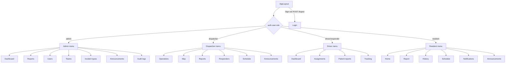

# Navigation and Route Flows

## Entry and authentication

| Page | URL / route name | Access | Source |
|---|---|---|---|
| Login | `/` (`login`) | Public | `routes/web.php`; `resources/js/Pages/Login.tsx` |
| Role redirect | `/dashboard` (`dashboard`) | `auth` | `routes/web.php` |
| Logout | `POST /logout` (`logout`) | `auth` | `routes/web.php`; `resources/js/Layouts/AppLayout.tsx` |

```mermaid
flowchart LR
    Root[/ /] --> Login[Login]
    Login -->|POST api.auth.login| Session{Authenticated?}
    Session -->|No| Login
    Session -->|Yes| Dashboard[/dashboard]
    Dashboard --> Admin[/admin]
    Dashboard --> Dispatcher[/dispatcher]
    Dashboard --> Driver[/driver]
    Dashboard --> Resident[/resident]
```

## Role navigation

### Admin

| Label | URL | Route name | Page source |
|---|---|---|---|
| Dashboard | `/admin` | `admin.dashboard` | `Pages/Admin/Dashboard.tsx` |
| Reports | `/admin/reports` | `admin.reports.index` | `Pages/Admin/Reports/Index.tsx` |
| Users | `/admin/users` | `admin.users.index` | `Pages/Admin/Users/Index.tsx` |
| Response Teams | `/admin/response-teams` | `admin.response-teams.index` | `Pages/Admin/ResponseTeams.tsx` |
| Incident Types | `/admin/incident-types` | `admin.incident-types.index` | `Pages/Admin/IncidentTypes/Index.tsx` |
| Announcements | `/admin/announcements` | `admin.announcements.index` | `Pages/Admin/Announcements/Index.tsx` |
| Audit Logs | `/admin/audit-logs` | `admin.audit-logs.index` | `Pages/Admin/AuditLogs.tsx` |

### Dispatcher

| Label | URL | Route name | Page source |
|---|---|---|---|
| Operations | `/dispatcher` | `dispatcher.dashboard` | `Pages/Dispatcher/Dashboard.tsx` |
| Live Map | `/dispatcher/map` | `dispatcher.map` | `Pages/Dispatcher/Map.tsx` |
| Reports | `/dispatcher/reports` | `dispatcher.reports.index` | `Pages/Dispatcher/Reports/Index.tsx` |
| Responders | `/dispatcher/responders` | `dispatcher.responders.index` | `Pages/Dispatcher/Responders.tsx` |
| Schedule | `/dispatcher/schedule` | `dispatcher.schedule.index` | `Pages/Dispatcher/Schedule.tsx` |
| Announcements | `/dispatcher/announcements` | `dispatcher.announcements` | `Pages/Shared/Announcements.tsx` |

### Driver / responder

| Label | URL | Route name | Page source |
|---|---|---|---|
| Dashboard | `/driver` | `driver.dashboard` | `Pages/Driver/Dashboard.tsx` |
| Assignments | `/driver/assignments` | `driver.assignments` | `Pages/Driver/Assignments.tsx` |
| Patient Reports | `/driver/reports` | `driver.reports` | `Pages/Driver/Reports.tsx` |
| Tracking | `/driver/tracking` | `driver.tracking` | `Pages/Driver/Tracking.tsx` |

### Resident

| Label | URL | Route name | Page source |
|---|---|---|---|
| Home | `/resident` | `resident.dashboard` | `Pages/Resident/Dashboard.tsx` |
| Report Emergency | `/resident/report` | `resident.report` | `Pages/Resident/Report.tsx` |
| My Reports | `/resident/history` | `resident.history` | `Pages/Resident/History.tsx` |
| Book a Service | `/resident/schedule` | `resident.schedule` | `Pages/Resident/Schedule.tsx` |
| Notifications | `/resident/notifications` | `resident.notifications` | `Pages/Resident/Notifications.tsx` |
| Announcements | `/resident/announcements` | `resident.announcements` | `Pages/Shared/Announcements.tsx` |

## Navigation flow



`AppLayout.tsx` closes the mobile `Sheet` after a navigation click. `app-sidebar.tsx` contains a separate legacy/admin-only navigation with placeholder page identifiers and no working logout handler; it is not the navigation used by the current page layout.
