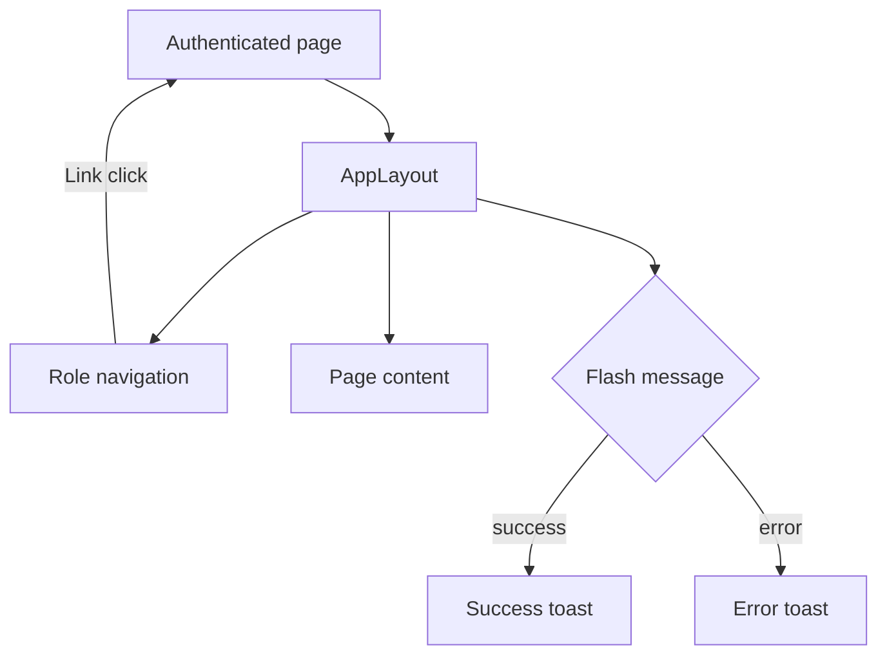

# Shared UI and Announcement Feed

## Shared layout

`resources/js/Layouts/AppLayout.tsx` is used by authenticated pages. It provides:

- role-dependent navigation from the `NAV` map;
- active link styling;
- mobile navigation `Sheet`;
- authenticated user identity and POST logout;
- success/error toast rendering from Inertia flash props.

## Announcement feed

`Pages/Shared/Announcements.tsx` is rendered by `AnnouncementFeedController` for dispatcher and resident announcement routes. It is read-only and supports server-backed search/category filters and pagination. Admin announcement CRUD is documented in [admin.md](./admin.md).

## Other reusable interactions

- `FilterBar`, `FilterSelect`, and `useServerFilters` provide query-string filters.
- `ServerPagination` navigates paginated links.
- `LocationMap`, `DriverMap`, `IncidentHeatMap`, and `LocationPicker` provide map display/selection.
- `StatusBadge`, `EmptyState`, `PageHeader`, and `StatCard` are display helpers; they have no network actions.
